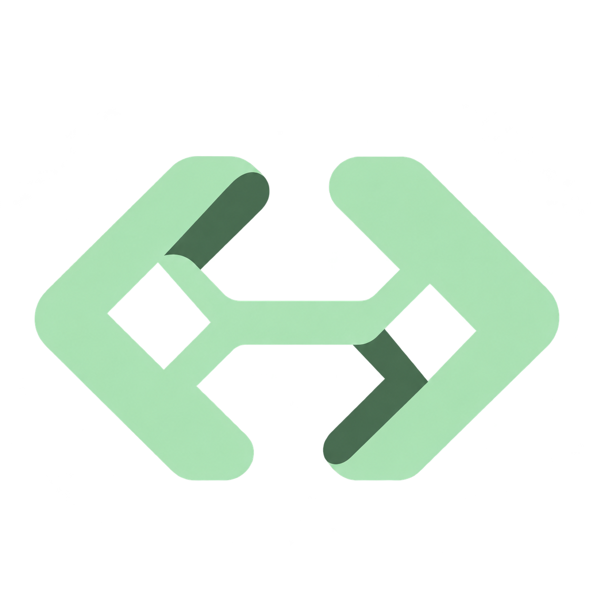

<p align="center"></p>

# Codex-Web

**Codex im Browser: Projekte verwalten, Chats führen und auf einem eigenen Codex-Host arbeiten.**

[English](README.md) · [Dokumentation](docs/wiki/de-Home.md) · [Releases](https://github.com/Tweak90/codex-web/releases) · [Changelog](CHANGELOG.de.md)

Codex-Web ist eine selbstgehostete Oberfläche für einen vorhandenen Codex App Server. Der Web-Container kann auf demselben Rechner oder auf einem anderen Docker-Host laufen. Anmeldung, Werkzeuge und Projektdateien bleiben auf dem Codex-Host.

> **Dieses Projekt wurde vollständig mit KI entwickelt. Die Nutzung erfolgt auf eigene Gefahr.**

## Funktionen

- Echte Projektordner mit mehreren Chats, Projektvorgaben und Kontextmenüs.
- Live-Chats, Freigabe- und Rückfragedialoge, Archiv, Suche und gespeicherte Entwürfe.
- Datei- und Bilduploads, Zwischenablage und Projektgalerien mit inhaltsbasierter Zusammenfassung identischer Bilder.
- Dateiexplorer, Editor, ZIP-Downloads, lesende Git-Ansicht und Konsole.
- Aufgabenübersicht, optionale Hinweise, Kontext- und Kontingentanzeige.
- Helle und dunkle IDE-Ansicht, Desktop und Mobilgeräte, Deutsch und Englisch.
- Zahnrad-Menü mit Einstellungen, deren Vorrang gegenüber ENV-Werten klar angezeigt wird.

Standardmäßig fügt **Enter einen Zeilenumbruch** ein und **Shift+Enter sendet**. Diese Belegung lässt sich umkehren. Der Chat-Reiter zeigt die Chatliste; nach einem Reiterwechsel im selben Projekt kehrt er zum geöffneten Chat zurück.

## Voraussetzungen

Ein angemeldeter, laufender Codex App Server (verifiziert mit **0.166.0**), Docker auf dem Web-Host und Netzwerkzugang zur Codex-API. Für die Projekt- und Dateiwerkzeuge werden Python 3 und Git auf dem Codex-Host benötigt. Der mitgelieferte Gateway verbindet bei Bedarf den lokalen Control-Socket mit WebSocket.

## Fertiges Docker-Image starten

Das fertige Image `ghcr.io/tweak90/codex-web-ui:latest` für Linux/amd64 benötigt weder Git-Checkout noch eigenen Build. Öffentliche Pakete erfordern keine Registry-Anmeldung. Für eingeschränkte Pakete zuerst mit einem leseberechtigten Konto `docker login ghcr.io` ausführen.

Eine Datei `.env.web` anlegen:

```dotenv
CODEX_WS_URL=ws://codex-host.example:4500
CODEX_API_TOKEN=replace-with-your-gateway-token
HOST_LABEL=Codex-Host
```

```bash
docker volume create codex-web-data
docker pull ghcr.io/tweak90/codex-web-ui:latest
docker run -d --name codex-web --restart unless-stopped --init \
  -p 8787:8787 --env-file .env.web \
  -v codex-web-data:/data \
  ghcr.io/tweak90/codex-web-ui:latest
```

Beispielhostnamen und Token ersetzen, `http://web-host.example:8787` öffnen und ein Passwort mit mindestens vier Zeichen festlegen. Das Datenvolume bei Updates beibehalten.

Gateway und Compose beschreibt die [Installationsanleitung](docs/wiki/Installation.md). [compose.image.yml](compose.image.yml) verwendet das fertige Image; [compose.yml](compose.yml) baut aus dem Quellcode.

## Updates und Einstellungen

`latest` neu laden und den Container mit derselben Umgebungsdatei und demselben Volume ersetzen. Die [Update-Anleitung](docs/wiki/Betrieb-und-Updates.md) enthält die vollständigen Docker-Befehle. Updates führt der Betreiber aus.

Das Zahnrad öffnet Sprache, Enter-Belegung, Behandlung von Folgenachrichten und Anwendungskonfiguration. **Leeres Feld: ENV gilt. Ausgefülltes Feld: Einstellung hat Vorrang.** Geheime Werte bleiben verborgen; **ENV verwenden** entfernt einen gespeicherten Override. Ports, Mounts, Image-Auswahl und Gateway-Parameter werden in Docker/Compose eingerichtet. Siehe [Konfiguration](docs/wiki/Konfiguration.md).

## Dokumentation und Entwicklung

Die [Dokumentation](docs/wiki/Home.md) beginnt mit einer Sprachauswahl. Sie behandelt Einrichtung, Benutzung, Fehlerbehebung, Architektur, APIs, Datenhaltung und Techstack. Alle Seiten sind direkt im Repository auf Deutsch und Englisch verfügbar.

```bash
npm ci
CODEX_SOCKET="$HOME/.codex/app-server-control/app-server-control.sock" npm start
npm test
npx playwright install chromium
npm run test:browser
npm run check:docs
npm run check:i18n
npm run check:publication
```

Für lokale Entwicklung ist Node.js ab Version 22 nötig. Weitere Informationen: [Techstack und Entwicklung](docs/wiki/Techstack-und-Entwicklung.md). Die Oberfläche ist ein eigenständiges Projekt und kein offizielles OpenAI-Produkt.
