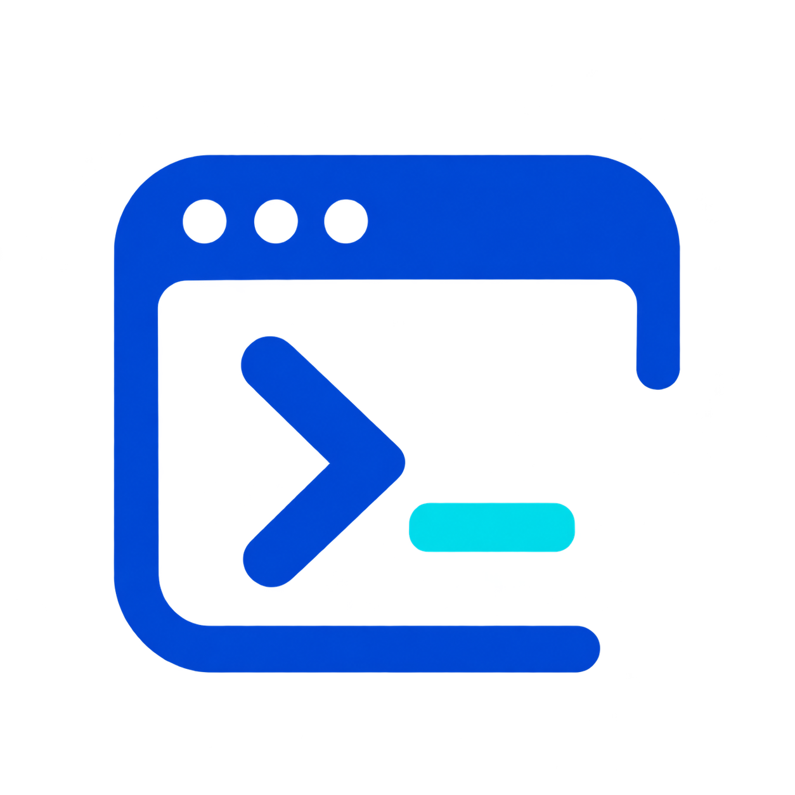
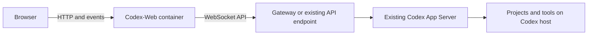

<p align="center"></p>

# Codex-Web

**Your Codex projects, chats and tools in a self-hosted browser interface.**

[Deutsch](README.de.md) · [Wiki](https://github.com/Tweak90/codex-web/wiki) · [Documentation](docs/wiki/en-Home.md) · [Releases](https://github.com/Tweak90/codex-web/releases) · [Changelog](CHANGELOG.md)

Codex-Web connects to an existing Codex App Server. Run the web container on the same machine or a separate Docker host. Your Codex sign-in, tools and project files stay on the Codex host.

> **This project was built entirely with AI. Use it at your own risk.**

## Features

- Real project folders, multiple chats, project defaults and context menus.
- Streaming chats, approval and question dialogs, archive, search and saved drafts.
- File uploads, pasted images and project galleries that group identical images by content.
- File explorer, editor, ZIP downloads, read-only Git view and terminal.
- Task overview, optional notifications, context usage and account usage limits.
- Light and dark themes, desktop and mobile layouts, German and English.
- Gear menu for settings with explicit precedence over environment variables.

By default, **Enter inserts a newline** and **Shift+Enter sends**. You can reverse this in Settings. The Chat tab lists project chats and returns to your open chat when switching tabs within a project.

## Requirements

- A running, signed-in Codex App Server; verified with **Codex 0.166.0**.
- Docker on the web host and network access to the Codex API endpoint.
- Python 3 and Git on the Codex host for project and file tools.
- The included gateway if you need to expose a local Codex control socket over WebSocket.



## Run the published Docker image

The published image is `ghcr.io/tweak90/codex-web-ui:latest` for Linux/amd64. No source checkout or local build is needed. Public packages require no registry sign-in; for restricted packages, first run `docker login ghcr.io` with an account that has read access.

Create `.env.web` with your own API address and gateway token:

```dotenv
CODEX_WS_URL=ws://codex-host.example:4500
CODEX_API_TOKEN=replace-with-your-gateway-token
HOST_LABEL=Codex-Host
```

```bash
docker volume create codex-web-data
docker pull ghcr.io/tweak90/codex-web-ui:latest
docker run -d --name codex-web --restart unless-stopped --init \
  -p 8787:8787 --env-file .env.web \
  -v codex-web-data:/data \
  ghcr.io/tweak90/codex-web-ui:latest
```

Replace the `.example` hostname and token. Open `http://web-host.example:8787` and set a password of at least four characters. Keep the data volume for future updates.

Need the gateway or prefer Compose? Follow [Installation](docs/wiki/en-Installation.md). [compose.image.yml](compose.image.yml) runs the published image; [compose.yml](compose.yml) builds from source.

## Updates and configuration

Pull `latest` and recreate the container with the same environment file and data volume. The [update guide](docs/wiki/en-Operations-and-updates.md) includes the exact Docker commands. Updates are installed by the operator.

Use the gear button for language, Enter behavior, follow-up handling and application settings. **Empty field: use ENV. Filled field: the saved setting wins.** Secrets are hidden; **Use ENV** clears a stored override. Docker ports, mounts, image selection and gateway settings stay in Docker/Compose configuration. See [Configuration](docs/wiki/en-Configuration.md).

## Documentation and development

The [Wiki](https://github.com/Tweak90/codex-web/wiki) starts with a language chooser. It covers installation, usage, troubleshooting, architecture, APIs, data storage and the tech stack. All pages are also available in German and English [directly in this repository](docs/wiki/Home.md).

```bash
npm ci
CODEX_SOCKET="$HOME/.codex/app-server-control/app-server-control.sock" npm start
npm test
npx playwright install chromium
npm run test:browser
npm run check:docs
npm run check:i18n
npm run check:publication
```

Local development requires Node.js 22 or later. See [Tech stack and development](docs/wiki/en-Tech-stack-and-development.md). This is an independent project, not an official OpenAI product.
