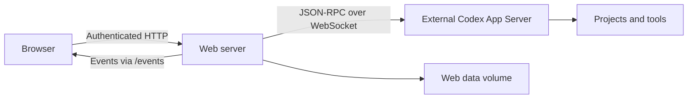

# Architecture

[Deutsch](architecture.de.md)

## Components

`server.mjs` serves HTML, JavaScript and CSS and authenticates control requests. The browser does not connect directly to the Codex host or hold OpenAI account credentials.

`lib/bridge.mjs` maintains the shared connection to the external Codex App Server API over `ws://` or `wss://`. It authenticates with the configured bearer token when provided. The web container runs only the web client; it contains no Codex process and requires no project-file or Docker mounts.

## Request lifecycle

1. Select or create a chat inside a project.
2. An empty chat is stored as a web draft.
3. The first message materializes it using `thread/start`.
4. `turn/start` sends text and image paths. Follow-ups use `turn/steer` or the native queue according to settings.
5. Events update messages, activities, tasks and questions.
6. Synchronous approvals retain the original request ID. Async questions retain their call ID and question index in a structured user reply.
7. Completion events update history and status and can advance a pending queue entry owned by this web client.

Codex can continue working after the browser is closed.

## Connections, settings and failures

RPC responses are matched by ID. Each connection has a generation; stale responses from older transports are ignored. WebSocket pings detect broken links. Disconnects reject open calls rather than resending them. Reconnection resubscribes to observed chats.

Saved nonempty settings override environment values; empty overrides restore ENV or defaults. Changing a connection reconnects the same bridge used by the stores. A pending API call blocks that change. Late errors from an old connection cannot terminate its replacement.

Queue starts and question replies record their delivery state before a mutating call. An uncertain result is not retried. Check the existing native history or queue before manually submitting further work.

## Large history and images

`lib/history.mjs` returns at most 20 stored entries per page. `thread/items/list` reads entries and `thread/turns/list` supplies bounded status metadata. A compatibility path pages individual turns rather than loading a whole thread.

Large generated-image contents are removed from history pages and loaded separately through an authenticated endpoint. Loaded image elements survive surrounding streamed updates. Requests are scoped to the active view so late results cannot replace another chat or project.

The gallery scans project and associated chat images. It skips internal runtime/cache folders and groups identical files by SHA-256. Only same-size candidates need content hashing; files that change during hashing are kept separate.

## Project and file operations

Native filesystem methods read and write files. Directory, Git, ZIP and management operations also use `command/exec` on the Codex host. Python verifies canonical paths and protects independently managed nested projects. Large transfers are chunked below native message limits. Temporary ZIP and upload staging files are removed when finished.

## Origin and compatibility

This project was built entirely with AI. Its UI, bridge, tests and configuration were written for this project. Official documentation and local protocol schemas informed the implementation. Another public web client's architecture was reviewed for context; no client source or UI assets were copied. The logo was also AI-generated; see the repository branding notes.

Compatibility is verified with Codex 0.166.0. Protocol changes require a new compatibility review. See the [official App Server documentation](https://learn.chatgpt.com/docs/app-server).

## Project agents

`lib/agents.mjs` lists native subagent threads for the selected project using `thread/list`, including archived threads. Their working directory must match the project. Agent output uses the same 20-entry history pages as chats and never resumes or starts agent work. `public/agents.js` provides filters, parent-chat links and periodic status/output refresh while the view is open. Runtime status is displayed as supplied; an unloaded agent is not guessed to be completed.
