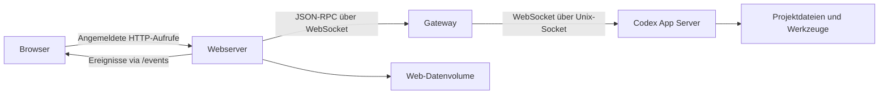

# Architektur

[English](en-Architecture.md) · [Deutsche Startseite](de-Home.md)

## Komponenten

`server.mjs` liefert HTML, JavaScript und CSS aus. Steuerungsanfragen laufen authentifiziert über den Webserver. Der Browser verbindet sich nicht direkt mit dem Codex-Host und hält keine OpenAI-Anmeldedaten.

`lib/bridge.mjs` hält die gemeinsame Verbindung zum Codex App Server. Unterstützt werden `ws://`/`wss://` und der lokale Unix-Control-Socket. Der mitgelieferte `gateway.mjs` leitet Nachrichten unverändert vom Netzwerk-WebSocket zum vorhandenen Socket weiter. Ein eigener WebSocket-Endpunkt kann den Gateway ersetzen.

Ein Docker-Image enthält Webserver und Gateway. Compose wählt den jeweiligen Einstiegspunkt. Projektdateien und Codex-Anmeldung bleiben auf dem Codex-Host. Der Web-Container benötigt weder Codex-CLI noch Docker-Socket.

## Ein Auftrag vom Browser bis zum Modell

1. Der Benutzer öffnet oder erstellt einen Chat innerhalb eines Projekts.
2. Ein leerer Chat wird zunächst als Web-Entwurf gespeichert.
3. Beim ersten Senden wird über `thread/start` der native Verlauf angelegt.
4. `turn/start` übermittelt Text und gegebenenfalls Bildpfade; weitere Anweisungen verwenden je nach Einstellung `turn/steer` oder die native Warteschlange.
5. Ereignisse aktualisieren Nachrichten, Aktivitäten, Aufgaben und Rückfragen.
6. Freigaben und Antworten werden mit der ursprünglichen Anfrage-ID zurückgeschickt.
7. Abschließende Ereignisse ergänzen Verlauf und Status.

Der Browser kann geschlossen werden, während Codex auf dem Host weiterarbeitet.

## Verbindung und Fehler

RPC-Antworten werden anhand ihrer IDs zugeordnet. Jede Transportverbindung besitzt eine Generation; verspätete Antworten älterer Verbindungen werden verworfen. WebSocket-Pings erkennen unterbrochene Verbindungen. Offene Aufrufe werden bei einem Abbruch abgewiesen, nicht erneut abgesendet. Nach der Wiederverbindung werden beobachtete Chats erneut abonniert.

Das ist kein automatisches Wiederholen eines Arbeitsauftrags. Bei einem unklaren Ergebnis muss zunächst der bestehende Verlauf geprüft werden.

## Große Verläufe und Bilder

`lib/history.mjs` liefert höchstens 20 gespeicherte Einträge pro Seite. `thread/items/list` liest Einträge, `thread/turns/list` ergänzt begrenzte Status-Metadaten. Ein Kompatibilitätsweg liest bei älteren Speichern einzelne Arbeitsdurchläufe statt des gesamten Chats.

Generierte Bilddaten werden aus diesen Seiten entfernt und gesondert über den authentifizierten Bild-Endpunkt geladen. Im Browser bleiben bereits angezeigte Bilder bei weiteren Ausgaben erhalten. Anfragen sind an die jeweilige Ansicht gebunden; verspätete Ergebnisse ersetzen keinen inzwischen ausgewählten Chat oder ein anderes Projekt.

## Datei- und Projektaktionen

Native Dateischnittstellen übernehmen Lesen und Schreiben. Verzeichnis-, Git-, ZIP- und Verwaltungsaktionen verwenden zusätzlich `command/exec` auf dem Codex-Host. Python prüft kanonische Projektpfade und schützt separat verwaltete Unterprojekte. Größere Dateiübertragungen laufen in Blöcken unterhalb der Nachrichtengrenzen. Temporäre ZIP- und Upload-Dateien werden nach Abschluss entfernt.

## Herkunft und Kompatibilität

Das Projekt wurde vollständig mit KI entwickelt. Oberfläche, Bridge, Gateway, Tests und Konfiguration wurden für dieses Projekt erstellt. Zur Recherche wurden die offizielle API-Dokumentation und Protokollschemata der installierten Codex-Version verwendet. Die Architektur eines anderen öffentlichen Codex-Web-Projekts wurde zur Einordnung gelesen; daraus wurden keine Quellcodedateien oder UI-Assets übernommen. Das Logo ist ebenfalls KI-generiert; Details stehen in der Branding-Dokumentation des Repositorys.

Verifiziert ist Codex 0.166.0. Änderungen am App-Server-Protokoll erfordern eine erneute Kompatibilitätsprüfung. Die [offizielle Dokumentation](https://learn.chatgpt.com/docs/app-server) beschreibt den App Server und seine Transportschnittstellen.

Gespeicherte Einstellungen überschreiben ENV-Werte, solange sie nicht leer sind. Rückfrageantworten und Warteschlangenstarts speichern den Versandstatus vor dem Aufruf. Unbestätigte mutierende Aufrufe werden nicht erneut gesendet. Die Galerie fasst identische Dateien per SHA-256 zusammen und lässt interne Runtime-/Audit-Verzeichnisse aus.
